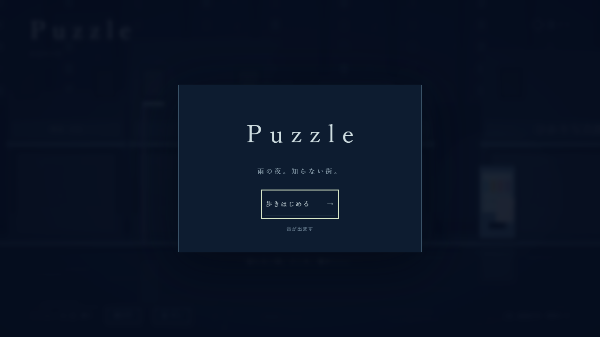
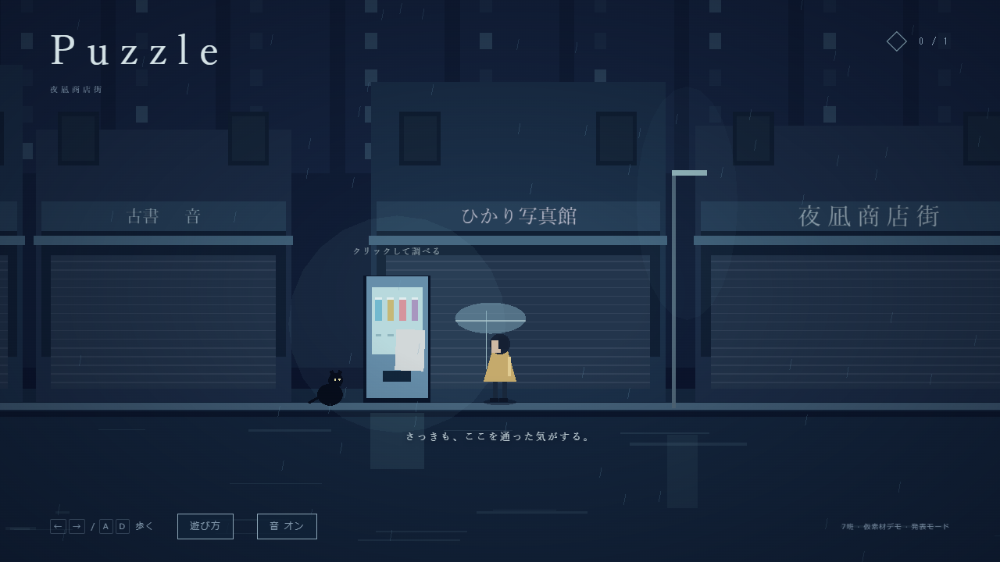
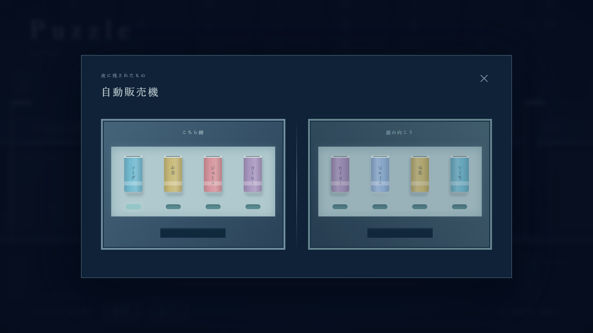

# 授業デモ用の改善：音・ループの変化・発表モード（2026-10-25）

本人の依頼: 「A（雨音とSE）、B（ループに気づける変化）、C（説明を減らした発表モード）を今夜実装して、検証してからpushして。」目的は翌日の授業でデモを見せ、改善点を探すこと。

## 背景（資料との照合で見つかった点）

- 仕様書07・企画PPTX「問題の説明はほとんどない。雰囲気で分かるデザインが必要」に対し、前回追加した初見向けの説明は答えに近い内容まで書いていた。ただし本人が説明なしでは遊べなかったことも事実なので、通常モードの説明は残し、説明を減らした版を別モードとして用意した。
- 仕様書「何度進んでも同じところに帰ってきてしまう」に対し、ループの継ぎ目が見えず、気づけるのは独白1行だけだった。
- 無音だった。

## 変更

- A: `src/audio.ts`。音素材を使わず Web Audio で雨音（2帯域のノイズ＋雨粒）、パズルを開く音、正解のチャイム、ループのうなりを生成。パズル中は雨音をこもらせる。画面下に「音 オン/オフ」。最初のクリックかキー入力で開始。
- B: `src/loopEcho.ts`。ループごとに画面が一瞬明滅し、看板の文字が1つずつ消え、独白が変わり、最後は「この街は、何かが欠けている。」に落ち着く。2回目のループから、同じ黒猫が自販機を見つめて座る（山口さんの「猫が飛び出る」案の一部を、ループの目印として仮採用）。自販機に初めて近づくと「この自販機、どこか欠けている。」
- C: `?mode=present`。起動はタイトルのみ。次の行動案内とパズル内の説明文を出さない。12秒後に鏡側の違う缶がかすかに明滅し、24秒後に一言だけ表示。誤答無反応（PM回答⑤）を守るため、ヒントは時間経過だけで出す。「遊び方」ボタンは保険として残す。

PM回答の進行（誤答無反応、正解で修復＋断片＋ループ解除、右の先でデモ終了）は変更していない。仕様原本は改訂していない。音・猫・看板の欠け・独白・秒数はすべてデモ用の仮演出。

## 検証

- `npm run build`: 型検査と本番ビルド成功。既知のThree.jsバンドルサイズ警告のみ（約576KB、gzip約148KB）。
- `npm test`: 7件成功（ループ演出の2件を追加）。
- `npm run test:e2e`: 3件成功（1.4分）。通常モードの既存2件に加え、発表モードでタイトル、音の開始、ループ時の独白と音、説明文の非表示、誤答で何も起きないこと、時間経過のヒント、正解のチャイム、音のオフを確認。
- 2回ループ後の黒猫と看板の欠けを画像で目視確認。
- 音は実際に耳で聞いて確認していない（自動試験では再生の呼び出しのみ確認）。授業前に教室のPCとスピーカーで音量を確かめること。MacBook・Safariも未確認。

## 授業での見せ方の例

1. `?mode=present` で説明なしのまま誰かに操作してもらい、ループと自販機に気づくかを見る。
2. 詰まったら「遊び方」を開く。説明が必要になった箇所自体を改善点として記録する。
3. 聞くこと: ループに気づいたか／パズルの目的が雰囲気で分かったか／「鏡」は水たまりの方が伝わるか／「アートに近いゲーム」と感じたか。

## 追記：起動を簡単に（2026-10-25）

本人の訂正: 「起動方法が難しすぎる。どうにかもっと楽にできないのか。」

`npm ci` → `npm run dev` → URLを開く、という手順をやめ、リポジトリ直下の `play/Puzzle_発表モード.html`（説明を減らした版）と `play/Puzzle_説明あり.html` をダブルクリックするだけで遊べるようにした。JS と CSS をHTML1ファイルに埋め込んでいるため、Node.js・サーバー・ネット接続は不要。生成は `web-demo` で `npm run play`。

検証: Playwright Chromium で2つのファイルを `file://` で直接開き、発表モードは開始・音の開始・自販機・正解まで、説明ありは「遊び方」の表示を確認（2件成功）。既存の試験と合わせて単体7件・ブラウザ5件成功。実際のダブルクリック（既定ブラウザ）と Mac・Safari は未確認。

## 追記：GitHub Pages で公開（2026-10-25）

本人の依頼: 「githubでクラウドで実行するやつ…それやってほしい」。`.github/workflows/pages.yml` で、main への push（`web-demo/` かワークフローの変更）ごとに GitHub 上で `npm ci`・`npm test`・`npm run build` を行い、GitHub Pages に公開する。Pages の有効化（Settings → Pages → Source: GitHub Actions）は本人が設定した。リポジトリはもともと公開設定。

- 発表モード: https://eitag0128.github.io/game-seminar-team7/?mode=present
- 説明あり: https://eitag0128.github.io/game-seminar-team7/

検証: Actions 実行 40192603931 成功。公開URLを Playwright Chromium で開き、発表モードで開始・音の開始・自販機・正解（断片取得）まで、説明ありで「遊び方」の表示を確認した。教室のPC・Mac・Safari での表示は未確認。

## 追記：音なしで遊べるように・文言の書き直し（2026-10-25）

本人の訂正: 「音無しでも遊べるようにしてほしいのと、AI特有の言葉の言い回しをやめてほしい。」

- 開始時（タイトル／遊び方）に「音ありではじめる」「音なしではじめる」を選ぶ。音なしでは音声処理自体を始めない。画面下の「音 オン/オフ」で途中でも切替でき、設定はブラウザに保存。音だけで伝える情報はない。
- 画面の文言を書き直した。「知らない街。どこか、懐かしい。」「……また、同じ場所。」「雨の匂いを、覚えている。」「知らない道が、続いている。」のような、読点で溜める言い方・「……」・抽象的な詩的表現をやめ、「ここはどこだろう。」「あれ、さっきの場所に戻ってる。」のような普通の言い方と、です・ます調の案内にした。記憶の断片は「小さいころ、雨の日にこの自販機でジュースを買ってもらった。」という具体的な一文（仮）。
- 店名も「夜凪」「月灯」「雨音」をやめ、「中央通り商店街」「喫茶 ポプラ」「中村書店」など普通の名前にした（仮）。

検証: 単体7件、ブラウザ6件成功（音なしで最後まで遊ぶ試験を追加）。タイトル・遊び方・記憶の画面を目視確認。`play/` のHTMLも作り直した。

## 追記：発表モードを廃止し、説明ありの1種類に統一（2026-10-25）

本人の訂正: 「なんで2つに分けるの。説明有りでいいでしょ。俺ですらゲーム性把握してないんだから。」

`?mode=present`（説明を減らした版、時間経過のヒント）を削除し、デモは「遊び方」付きの1種類だけにした。ダブルクリック版も `play/Puzzle.html` の1ファイルに統一。音あり/音なしの選択、ループに気づける変化（看板・黒猫・独白・明滅）はそのまま残した。上の「発表モード」の記述は当時の記録として残す。

検証: 単体7件、ブラウザ5件成功（ダブルクリック版を file:// で開いて最後まで遊ぶ試験を含む）。

## 追記：パズルを開く音とエンディングの文（2026-10-25）

本人の指摘: 「自販機を押すとシューンって感じで音がDJみたいに消える」「遊んでくれてありがとうございますはないだろ。デモだぞ。チームメンバーに見せるものだぞ。」

- パズル中に雨音の高い音を削るフィルター（DJ のように聞こえた）をやめ、音色はそのまま音量だけ下げるようにした。開く音も下へすべる音をやめ、短い「カチッ」にした（`src/audio.ts`）。
- エンディングの文を「デモはここまで」「この先（次のエリア・ほかのパズル）はまだ作っていません。」にした。

検証: 単体7件、ブラウザ5件成功。音は耳では未確認。

## 追記：フォントをゴシック体に（2026-10-25）

本人の指摘: 「フォントもどうにかできないの。明朝体で作れって言われたの？」「普通にうさんくせえなって思うよ。PMが決めたことはもちろんまもってほしいが。」

明朝体はどの資料にも指定がなく、最初の実装で雰囲気づけに選んでいただけだった。画面と看板の文字を Windows / Mac 標準のゴシック体（游ゴシック UI／ヒラギノ角ゴ ほか）に統一し、字間を広げる指定をすべて外した。小さすぎた文字（9〜10px）は 11〜13px に、見出しは太字にした。クリア後に同じ操作案内が2か所に出ていたため、上の一文は少女のつぶやき「右の道が通れるようになった。」に戻した。PM回答の進行・パズルは変更なし。

検証: 単体7件、ブラウザ5件成功。遊び方・街・パズル・記憶・クリア後の画面を目視確認。

## 追記：スマホ対応（2026-10-26）

本人の依頼: 「スマホ対応させて欲しい。」

- タッチ端末では画面下に ◀ ▶ ボタンを出し、押している間歩く。自販機・飲み物のボタンはタップで操作。
- 遊び方・画面下の案内・記憶の画面の文を、タッチ用（「タップ」「◀ ▶」）とキー用で出し分け。キーを押せばキー用に戻る。
- 縦向きの画面でも街が横に最低12ユニット見えるよう、足りない分は上下を広げるカメラにした。
- 横向き（高さ500px以下）では、操作案内を画面上へ移して少女と重ならないようにし、パズル画面を縦に詰めて1画面に収めた。遊び方は先頭から表示。
- ノッチ付き端末の余白（safe-area）を考慮。

検証: 単体7件、ブラウザ7件成功。スマホ横向き（844×390）でタッチ操作のみで最後まで遊べること、縦向き（390×844）でボタン・ダイアログが画面内に収まることを Playwright Chromium のモバイル表示で確認し、画面を目視確認した。実機（iPhone / Android）は未確認。iPhone はマナーモードだと音が出ない。

## 追記：少女をデザイナーの待機画に差し替え（2026-10-27）

本人の依頼: 「待機画がデザイナーから送られてきた…どうぞこれで入れてください。」（Discord team7_役職別連絡 › プログラマー、山口さん投稿の待機画）

- 背景透過の PNG（810×1080）を余白で切り、高さ640pxに縮小して `web-demo/src/assets/girl-idle.png` に置いた。JS に埋め込むので、ダブルクリック版でも表示される。
- 仮の図形の少女を、この絵を貼った板に置き換えた。足元を地面に合わせ、高さは自販機とほぼ同じ（傘込みで2.9）。夜の街から浮かないよう、少しだけ青暗く乗算している。
- 絵は1枚なので、歩く時は向きに合わせて左右反転し、上下に揺らすだけ。歩きの絵が届いたら差し替える。
- PM回答⑧「一旦、既存のラフ等は使用せず」は、デモ用に新しく届いた素材なので対象外と判断した。気になる場合は PM に確認する（本人に伝達済み）。

検証: 単体7件、ブラウザ7件成功（1回目は開発サーバーの応答待ちで1件が時間切れ、再実行で全件成功）。PC・スマホ横向き・縦向きで、少女が地面に立ち自販機と並ぶことを目視確認。

## 追記：歩き差分を入れる（2026-10-28）

本人の依頼: 「これで歩く差分も作ってくれたって」（山口さんの歩き差分2枚、「腰と手しか動かしてないから不自然かも」「可能であるなら入れてみて欲しい」）

- 待機画と歩き差分2枚は同じキャンバス（810×1080）で傘の位置も同じだったので、3枚を同じ枠で切り、高さ640pxに縮小（`girl-idle.png` / `girl-walk1.png` / `girl-walk2.png`）。切り替えても頭や傘がずれない。
- 歩き差分の2枚は脚が同じ形なので、2枚だけを交互に出すと脚が止まって見える。間に待機画（脚がそろった形）を挟み、歩き1→待機→歩き2→待機を0.16秒ずつ切り替えて、脚が開く・閉じるを見せるようにした。止まると待機画に戻る。
- 以前の「上下に揺らす・傾ける」代用はやめ、待機画のコマで少しだけ体が上がるだけにした。

検証: 単体7件、ブラウザ7件成功。歩行中の画面を連続で撮り、コマが切り替わり、頭と傘の位置がずれないことを目視確認。
