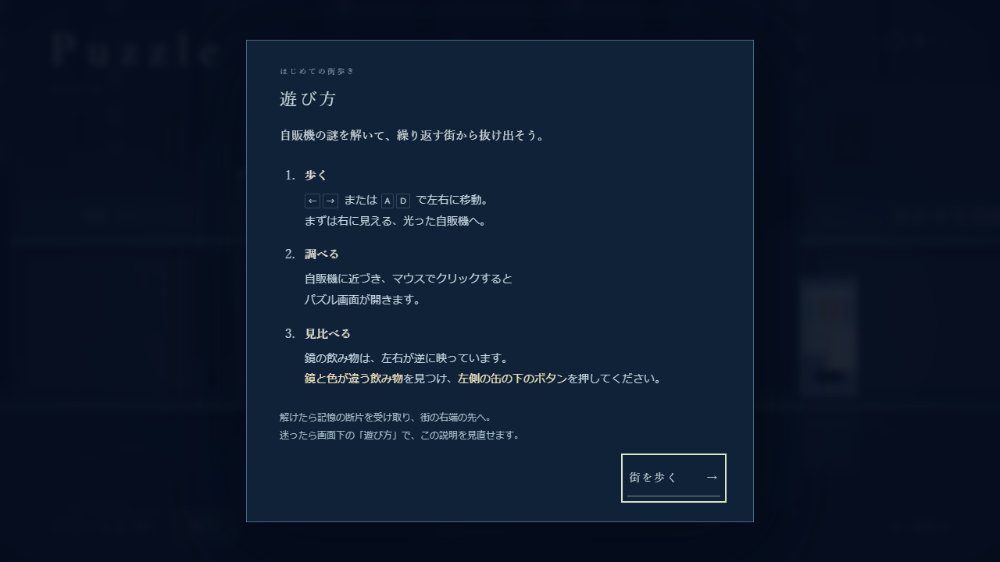
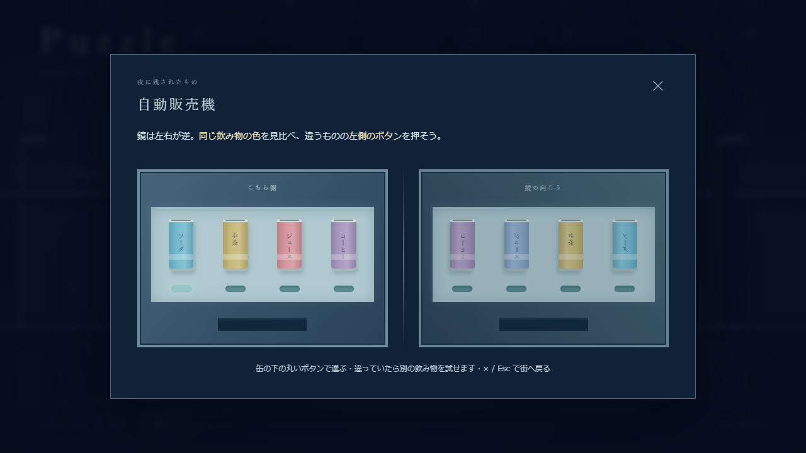

# 初見向けの操作説明追加（2026-10-25）

本人の訂正: 「チュートリアルというか、説明を入れないと俺も遊び方がわからない。どうする。」

## 変更

以前は画面下の小さいキー案内と「映っているのは、同じもの？」という文だけだった。目的、対象への近づき方、押すボタン、解いた後の進路が初見で分からなかったため、ゲーム内で次を説明する。

- 起動時に「遊び方」を自動表示。目的、左右移動、自販機への接近とクリック、鏡との色の比較、左側の缶の下のボタン、クリア後の進路を示す。
- 「街を歩く」で開始。画面下の「遊び方」から再表示でき、説明中は移動しない。閉じても進行状態を保持する。
- 街では下部に現在の次の行動を表示。探索、自販機のクリック、クリア後の右端への移動を状況に応じて切り替える。
- 拡大パズルには左右反転の説明、色を比較すること、押すのは左側のボタンであること、閉じ方を明記する。具体的な正解の飲料名は表示しない。
- 記憶取得時に修復とループ解除が起きたこと、街へ戻った後は右へ進むことを説明する。

本人の最新指示によるデモの説明改善であり、PM仕様の正誤判定・修復/断片/ループ解除を変更していない。正式仕様PDF等の原本は改訂していない。READMEとweb-demo/AGENTS.mdにも今回の訂正を反映した。

## 検証

- `npm run build`: 型検査と本番ビルド成功。既知のThree.jsバンドルサイズ警告のみ。
- `npm test`: 進行テスト5件成功。
- `npm run test:e2e`: 通常プレイと追加操作の全2件成功（29.5秒）。起動時案内、説明中の移動抑止、再表示と位置保持、パズル内の説明、クリア後の進路案内を確認した。
- 1280×720と800×600の説明画面/パズル、街の次行動表示を画像で目視確認した。小さい画面でも開始ボタンまで表示される。
- MacBook実機・Safariと本人の再プレイ受入は未確認。

今回の画面は新しい名前で保存し、前回の画面記録を残した。

