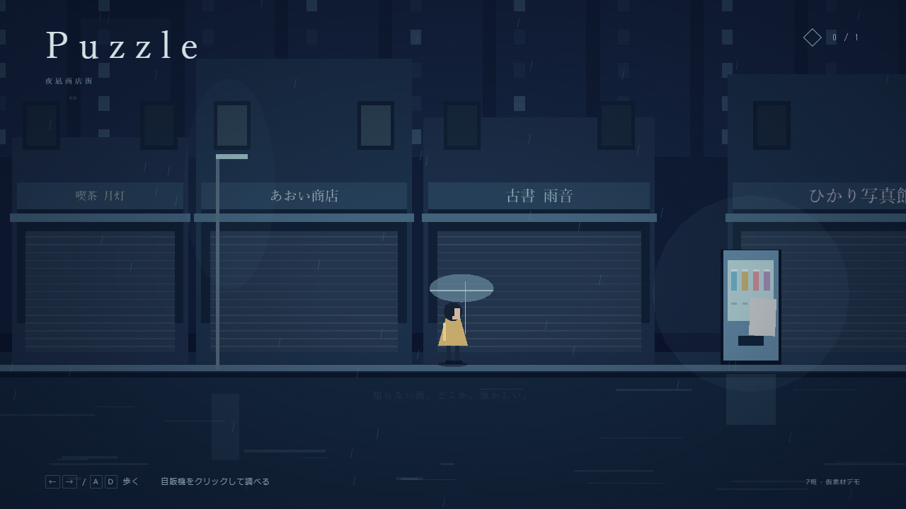
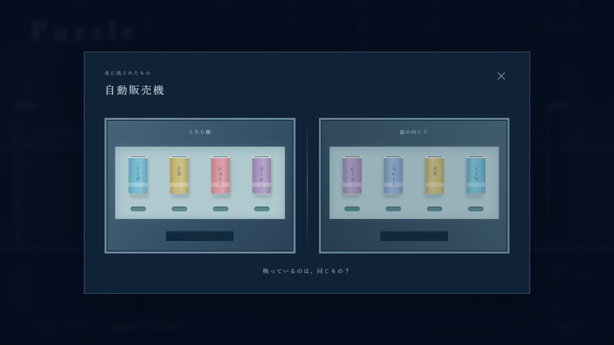

# Puzzle デモ 検証記録（2026-10-25）

## 実行した確認

Windows、Node.js 24.14.1、npm 11.11.0。Three.js 0.186.1、Vite 8.3.5、TypeScript 7.0.2、Playwright 1.64.1。依存解決は `web-demo/package-lock.json` に固定。

| 確認 | 結果 |
| --- | --- |
| `npm install` | 成功。Dドライブの `web-demo/node_modules` に導入 |
| `npm test` | 5件成功。左右ループ、操作距離、パズル中停止、誤答無反応、修復/断片/解除の同時更新、進行保持、先の道、再プレイ初期化、長いフレーム間隔の制限 |
| `npm run build` | 型検査と本番ビルド成功。Three.jsを含むJS約567KB/gzip約145KBでサイズ警告あり |
| `npm run check` | ブラウザテストの最終修正後も成功 |
| `npm run test:e2e` | 2件成功（30.6秒）。実際のキーボード/クリックで操作 |
| 通常プレイ試験 | 未修復でループ、自販機拡大、パズル中移動停止、Esc閉じ、誤答無反応、正答で修復＋断片1個、右端から次の場所、再プレイ。console/page errorなし |
| 追加操作試験 | Aで左端ループ、入力保持中のフォーカス喪失で停止、矢印移動、800×600でパズルが画面内に収まり、閉じ操作が機能 |
| ビルド済み版 | `npm run preview`、HTTP 200。本番JSで描画→移動→パズル→正答→修復を確認。console/page error 0、外部ネットワーク要求0 |
| 目視 | 1280×720の街/拡大パズル/修復後/終了画面と800×600のパズルを画像で確認。元サンプルの忠実再現を検証したものではない |
| 原本保全 | Gドライブ原本9ファイルのSHA-256が作業前後で一致。既存追跡ファイルの差分なし |
| Git除外 | `node_modules`、`dist`、`test-results`、`.env` が除外されることを確認 |

ブラウザ試験の初回は、テスト側の移動待ちが操作距離を通り過ぎて停止したため1件失敗した。キャラクター位置の粗いポーリングを、自販機が操作可能になったことを50ms間隔で待つ方式に修正し、全2件の成功を確認した。成功のためにゲームの操作距離やクリア条件を緩和していない。

## 画面

ビルド済み版から取得。どちらも今回作った仮素材・仮パズルで、資料原本の画像ではない。

## 未確認・限界

- MacBook実機、Safari、Firefoxは未検証。MacBook用には同じnpmコマンドとlockfileを用意した。
- パズルサンプル実画像・正式キャラクター/背景素材は未確認。現在の配置・文章は仮実装。
- 水彩画レイヤー・音・永続セーブ・正式な次ステージは今回の対象外。
- PM鈴木さんと本人による実プレイの受入は未実施。技術試験の成功と区別する。
- 外部公開は未実施。GitHubでソースを共有するローカル開発環境。
